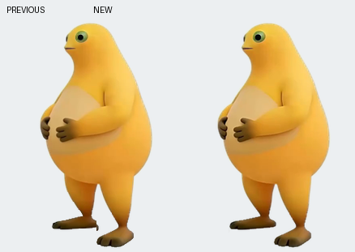
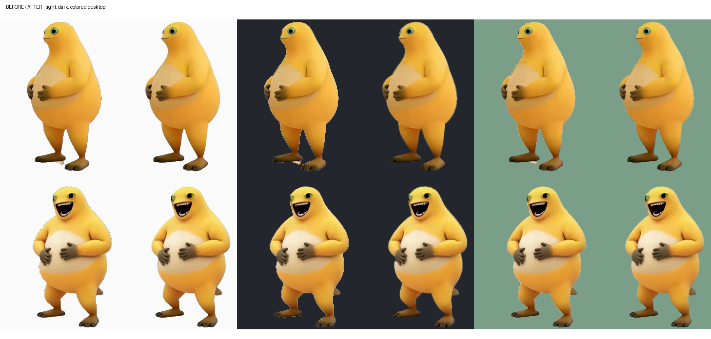

# 奶龙桌宠 · Nailong Desktop Pet

一个基于 Python 和 Win32 分层窗口的 Windows 桌面宠物，支持逐像素透明、鼠标互动、散步与分裂玩法。

<p align="center">
  
</p>

本仓库提供程序源码、素材处理工具和测试。普通用户可在提供 EXE 发行包后直接下载运行；从源码运行或自行打包时，动画、音频及图标需要自行准备，具体见 [素材说明](ASSETS.md)。代码使用 MIT 许可证；该许可证不授予奶龙角色或第三方素材的使用权。

## 效果展示

### 行走动画

左侧为优化前，右侧为优化后。预览展示连续步态和脚部边缘的变化。

<p align="center">
  
</p>

### 不同背景下的画质

从左到右分别为浅色、深色和彩色背景；每组左侧为优化前，右侧为优化后。上排为待机，下排为大笑。



以上为程序素材与离屏渲染预览。角色和展示素材不包含在源码的 MIT 授权中，见 [素材说明](ASSETS.md)。

## 下载运行（EXE）

适用系统：Windows 10/11。

提供预编译版本后，在本仓库的 **Releases** 页面下载 `NailongPet.exe`，放到有写入权限的文件夹，双击即可运行。如果下载的是 ZIP 发行包，请先完整解压再运行。

EXE 已打包 Python、运行依赖和所需素材，使用者无需安装 Python、执行 `pip install` 或另外下载素材。程序设置和日志保存在 EXE 旁边。

目前尚未在 GitHub 发布发行包；发布后可按上述方式下载。以下依赖安装、源码运行和打包步骤仅供开发者使用。

## 功能

- 左键拖动，轻点触发大笑，连续点击逐渐长大并生成新的桌宠。
- 在屏幕工作区底部散步，两条腿交替迈步，碰到边缘自动转向。
- 眼睛跟随鼠标；鼠标进入肚皮区域时触发局部弹动和可关闭的音效。
- 右键调整大小、点击次数、每次生成数量、自动大笑和声音。
- 记住设置、位置和朝向；新生桌宠结束动作后自动收敛。
- 高采样绘制、预乘透明度缩放、待机补间和连续形变；目标约 60 帧，实际速度取决于尺寸、数量和电脑性能。

## 开发环境

Windows 10/11，64 位 Python。建议使用 Python 3.12。程序依赖 Windows 的 `user32`、`gdi32` 和 `winmm`，不能直接在 macOS 或 Linux 上运行。

`requirements.txt` 用于从源码运行；`requirements-dev.txt` 用于素材处理、测试和重新打包。直接使用 EXE 无需安装这些依赖。

## 从源码运行

在项目目录的 PowerShell 中执行：

```powershell
python -m venv .venv
.\.venv\Scripts\python.exe -m pip install -r requirements.txt
```

准备好自己有权使用的素材后，将 `sprite.dat`、`sprite.json` 和 `laugh.wav` 放入 `pet/`。如果已有兼容的本地素材目录，可以导入：

```powershell
.\.venv\Scripts\python.exe tools\prepare_assets.py --from-dir "D:\your-assets"
.\.venv\Scripts\python.exe tools\check_assets.py
.\.venv\Scripts\python.exe pet\nailong_pet.py
```

也可以双击 `start.bat`。该脚本优先使用项目内的 `.venv`，不依赖开发者电脑上的 Python 路径。

## 生成 EXE

```powershell
.\.venv\Scripts\python.exe -m pip install -r requirements-dev.txt
.\.venv\Scripts\python.exe tools\check_assets.py
.\.venv\Scripts\python.exe -m PyInstaller --noconfirm --clean NailongPet.spec
```

成品位于 `dist/NailongPet.exe`，也可以双击 `build.bat`。默认不跟踪 EXE 和打包缓存。公开发布包含素材的二进制前，需要先确认对应素材允许再分发。

## 测试

```powershell
.\.venv\Scripts\python.exe pet\_test_quality.py
.\.venv\Scripts\python.exe pet\_test_smooth_render.py
```

没有本地素材时，合成图像测试照常执行，依赖真实动画的测试会跳过。导入素材后，第二组测试检查各尺寸下的透明度、局部形变、镜像和完整步态中的碎片残影。

```powershell
.\.venv\Scripts\python.exe pet\_test_smooth_render.py --benchmark
```

基准测试报告离屏渲染耗时，不等同于桌面上的实际帧率。

## 项目结构

```text
pet/nailong_pet.py         窗口、互动、音频、状态保存和动画编排
pet/sprite_render.py       预乘透明度合成与局部形变
pet/build_sprites.py       抠图、边缘处理和精灵打包工具
pet/sprite.json            当前素材坐标系的元数据示例
tools/prepare_assets.py    将已有兼容素材导入本地
tools/check_assets.py      检查素材完整性和格式
NailongPet.spec            PyInstaller 打包配置
```

运行配置和日志存放在源码的 `pet/` 下；EXE 版本写在 EXE 旁边。请将程序放在有写入权限的目录。

## 参与开发

欢迎通过 Issue 描述问题，或提交 Pull Request。报告渲染问题时，请附 Windows 版本、显示缩放比例、桌宠大小和复现步骤；发布截图、日志前请先清理个人信息。

修改交互逻辑时保持笑声与动画同步；修改渲染时维持预乘 BGRA 的颜色通道不大于透明度，并检查左右镜像及脚部残影。

## 许可

源码采用 [MIT License](LICENSE)。第三方库遵循各自许可证；角色、视频、帧图、音频、图标及其衍生素材不包含在本项目的 MIT 授权中，见 [ASSETS.md](ASSETS.md)。
